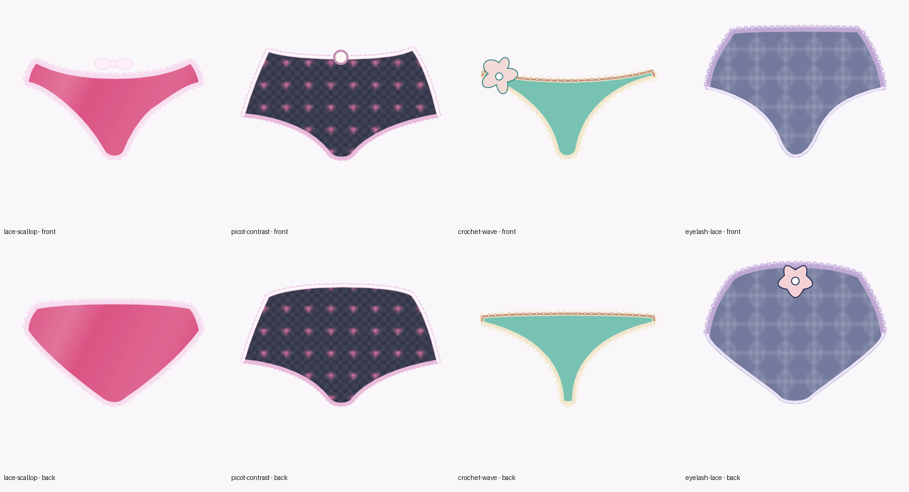

# UPIC — Universal Panty Identification Code

> **Release status:** UPIC `1.0.0-rc.3` is the proposed first public specification baseline. See [BASELINE.md](BASELINE.md) and [MIGRATION.md](MIGRATION.md). No hosted GitHub release or remote changes are implied by this archive.

**Portable design IDs, MIT-licensed SVG source code, and a deterministic SVG renderer.** PHP 8+, no database, package manager, frontend build, or API key needed.



UPIC extends the **original Panty Maker nine-byte positional design code** instead of replacing it with a prefix or a lookup-table ID. The first 12 code characters stay unchanged when extension records are appended. An original design without extensions keeps its original 12-character ID. A code describes the design, **not** ownership, identity, inventory, or permissions.

## Features

- **10 original cuts** and original pattern IDs, including hearts and registered small/large floral prints in the pre-existing pattern field.
- Reversible `encode()` / `decode()` and SVG `render()` for front and back.
- Independent front/back colours, print colour, trim colour, sheer level, and optional exact 24-bit RGB overrides.
- Fabrics including satin, cotton, lace, stretch lace, silk, chiffon, jersey, mesh and others.
- Edge-aligned **lace, scallops, picot, wavy, ruffled, zigzag and eyelash** treatments.
- Distinct waist/left-leg/right-leg trims; up to four trim layers and decorations.
- Structured hex reference registries that can be expanded without changing the core-byte positions.
- A local visual design laboratory and JSON/SVG HTTP endpoints.

> Rendering produces stylized SVG illustrations, not physically accurate garment patterns or textile manufacturing specifications. Adding a new cut requires artwork; placed trims additionally require registered contours.

## Try it locally

Requires **PHP 8.0+**. From the repository root:

```bash
php -S 127.0.0.1:8080
```

Open <http://127.0.0.1:8080/index.php> to use the interactive designer. For source, registry, and renderer checks:

```bash
python3 tools/svg_registry.py check
php tests/registry_contract.php
php tests/run.php
```

The only Python requirement is **optional**: regenerating edge contours from SVG paths using `tools/generate_contours.py` requires `fonttools` and `shapely`. The pre-generated JSON contours are committed, so end users don't need Python.

## PHP API

```php
<?php
require_once __DIR__ . '/src/UPIC.php';

$design = [
    'style' => 5, // bikini; registered cuts are numeric references
    'pattern' => 9, // small hearts
    'fabric' => 'stretch_lace',
    'colors' => [
        'front' => '#ce4279',
        'back' => '#ce4279',
        'trim' => '#ffffff',
        'pattern' => '#fff2f7',
    ],
    'trims' => [[
        'zone' => 'waist',
        'material' => 'lace',
        'edge' => 'scalloped',
        'width' => 3,
        'color' => '#ffffff',
    ]],
];

$code = UPIC::encode($design);
$decoded = UPIC::decode($code);
$frontSvg = UPIC::render($code, 'front');
$backSvg = UPIC::render($code, 'back');
```

For HTTP:

| Request | Purpose |
| --- | --- |
| `GET /api.php?code=CODE` | Decode code into JSON design |
| `POST /api.php` with JSON design | Return code and canonical design |
| `GET /render.php?code=CODE&side=front` | SVG for front (`back` also supported) |
| `GET /index.php` | Local interactive designer |

Do not expose the demo endpoints as an authenticated design ownership service. If publicly deployed, apply web-server request throttling and any additional application security controls appropriate for your host.


## Applications built on the protocol

- **[Style Brief](examples/style-brief/README.md)** — optional browser-only decoder that turns existing UPIC IDs into a human-readable design request and exportable JSON, without changing UPIC's wire format or requiring Panty Maker or a database. Open `examples/style-brief/index.html` locally. Its optional commercial fields (size, quantity, budget, notes) are deliberately **outside** the UPIC design code.

The Panty Maker website is a separate application. This repository remains the canonical UPIC code/registry/renderer implementation; Maker-specific layout and figure-alignment changes should not be copied into it. See [`INTEGRATION.md`](INTEGRATION.md).

## Design-code compatibility

- Core layout is **exactly nine binary bytes**: pattern colour, pattern ID, sheer level, trim colour, back colour, front colour, cut ID; see [`PROTOCOL.md`](PROTOCOL.md) for the precise nibble locations.
- Original IDs use Base64 with `+` → `*` and `/` → `|`.
- Extensions are append-only binary TLVs for new design data and a CRC32 for accidental-corruption detection; **not** a signature or anti-forgery mechanism.
- The core cut/pattern slots already allow 8-bit values (`00`–`FF`). Higher references use extension high-order bytes only after that range is exhausted.
- Codes from the prior experimental `F1`-marker UPIC implementation remain readable; new IDs do **not** emit that marker.

## Repository layout

```text
src/UPIC.php               PHP library: encode, decode, render
assets/svg/registry.json   Hexadecimal identity registry for all families
assets/svg/cuts/          Individual source SVGs for original cuts
assets/svg/patterns/      Individual source SVGs for original prints
assets/artwork.json        Compiled SVG templates for PHP compatibility
assets/cut_anchors.json    Registered detail anchors by cut
assets/edge_profiles.json  Front/back waist and leg contours by cut
index.php                  Visual design demo
api.php / render.php       JSON and SVG endpoints
examples/                  Preview renders
examples.json              Four demo code-and-design fixtures
tests/run.php              Regression and feature tests
tests/registry_contract.php  Registry and PHP agreement
tools/svg_registry.py      SVG validation and compatibility compiler
tools/generate_contours.py Optional edge-contour generator
SVG_SPEC.md                SVG-as-code rules for all vector families
GOVERNANCE.md              Merge policy and independent forks
PROTOCOL.md                Byte-level format, reference tables, renderer contract
```

## Using UPIC in another application

Save the UPIC string as a **design ID**. Your host application stores account relationships, collection metadata and ownership permissions separately. Anyone who knows a code can render that design; **possession of a code does not prove ownership**. Maker-to-Drawer transfers should use an authenticated API rather than treating the string as a token for authorization.

## Open-source SVG code and contributions

The original Panty Maker SVG creator has authorized releasing the original cuts and patterns **under the repository MIT License**. The license also covers the renderer, vector source, compiled SVG data, anchors, edge profiles, examples, tests and documentation. There is no separate art licensing requirement.

Every SVG is ordinary versioned source code. Contributors can add a numbered SVG file, allocate an appropriate hexadecimal reference through upstream review, run `python3 tools/svg_registry.py build` and submit a pull request with front/back renders. The current PHP renderer uses generated `assets/artwork.json` to retain exact historical compatibility. See [SVG_SPEC.md](SVG_SPEC.md) and [CONTRIBUTING.md](CONTRIBUTING.md).

Forking and independent deployment are permitted by MIT. Fork-only reference IDs must be clearly disclosed because IDs do not currently include a namespace; separate forks may allocate conflicting values. Upstream merges remain subject to maintainer approval. See [GOVERNANCE.md](GOVERNANCE.md).

Panty Lane trademarks are not included in the software license. UPIC is a project-maintained open specification and reference implementation, not an independently ratified international standard.

## Panty Maker v1.17 common print sync

The reference SVG registry now includes all 18 original/extended Maker pattern references (`00`–`11`). `0B`/`0C` are Small/Large floral; `0D` Leopard, `0E` Lace look, `0F` Stars, `10` Camouflage, and `11` Plaid. The SVG source for `0B`–`11` was imported **exactly** from Panty Maker v1.17 and is pinned by SHA-256 fixtures. The same code selects the same pattern on front and back; color and cut remain independently encoded.

To verify: `php tests/common_patterns.php`, `python3 tools/svg_registry.py check`, `php tests/run.php`, and `node examples/style-brief/tests/test.js`. See [`examples/common-patterns/README.md`](examples/common-patterns/README.md) for a review gallery. This repository remains the UPIC standard/reference implementation; it is not a drop-in replacement for the Panty Maker website.
